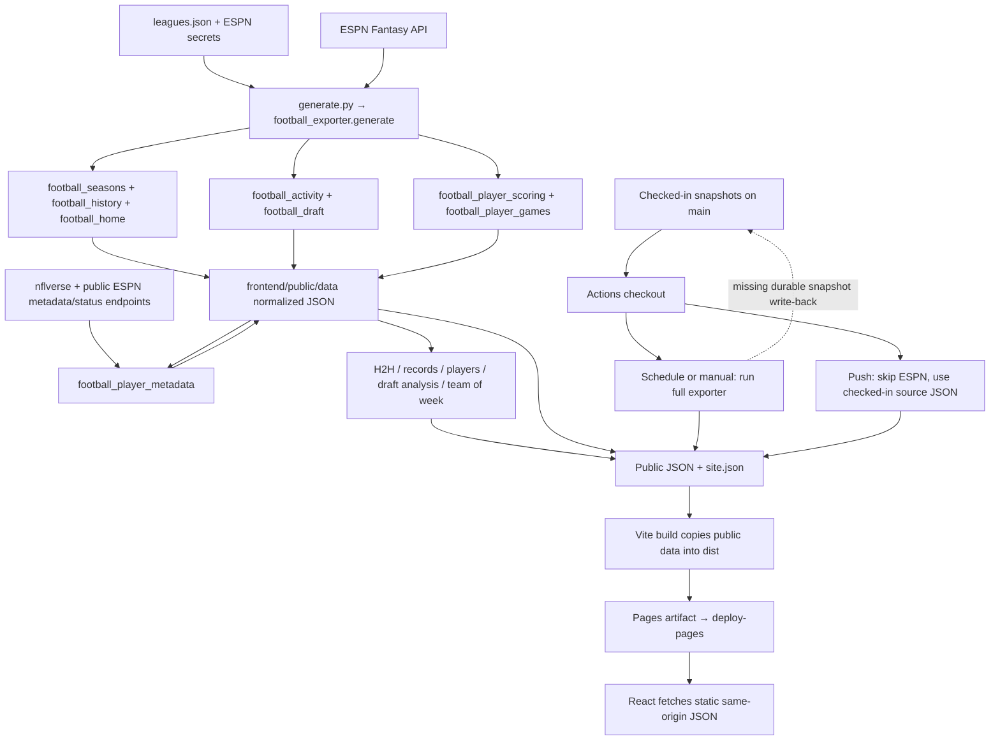

# Pocky Football — Data Architecture & Automatic Refresh Audit

Audit date: October 29, 2026 (America/New_York). Investigation and recommendations only.

## 1. Executive summary

**The strongest explanation is that successful code deployments restore stale checked-in JSON over the data produced by scheduled refreshes. Scheduling itself has not stopped.**

The only workflow, `.github/workflows/pages.yml`, is enabled (`state: active`). It schedules Monday, Tuesday, and Friday runs at 14:00 UTC, supports manual dispatch, and deploys pushes to `main`. All 13 retained scheduled runs succeeded, most recently October 27. That run's log explicitly records successful exporter completion. Both expected repository secrets exist under the correct names.

However, refresh outputs exist only in the runner and Pages artifact: the workflow never commits them or saves a durable source snapshot. Since commit `de4f271` on October 28, push runs explicitly skip ESPN generation. Each push starts with a clean checkout, rebuilds selected analytics from old normalized JSON, and publishes that old data. Nine successful push deployments followed the October 27 scheduled run. The newest deployment, October 29 at 17:28 UTC, skipped ESPN generation and published data still showing fantasy Week 4 with only Weeks 1–3 completed.

Public HTTP reads confirm that deployed `site.json`, Home, standings, teams, activity, and player game data equal the checked-in snapshots. This is not inferred from a code commit date or a browser screenshot. Fresh HTTP `Last-Modified` headers describe the deployment, not the age of the underlying sports data.

**Confidence boundary:** execution and deployment on October 27 are verified; the exact sports data generated in that run and whether it differed from its inputs are not recoverable from the available evidence. Its artifact listing is empty, and there is no hash manifest or core-data refresh timestamp. Publication rollback is established as a design defect and is the best-supported explanation for the current stale site; it is not proof that the October 27 source response was current.

The exporter does refresh an existing active season; it does not skip a year just because a directory exists. It is nevertheless a broad regeneration loop over 2021–2026, rather than an efficient incremental refresh. Fix publication persistence first, then add freshness gates, active-season scope, and a more useful game-day cadence. No rewrite is needed to address the primary defect.

## 2. Scope and safe environment inspection

- Repository: `fliou0704/pocky-football`; origin is `https://github.com/fliou0704/pocky-football.git`.
- Local branch: `codex/fix-season-overall-performance`, HEAD `d5609a6`.
- Working tree was clean before the audit. `origin/main` was fetched successfully, reaching merge commit `948fcf22841e2c3ffc9ff1e599b552696d536fab` (PR #19).
- HEAD is one commit behind fetched main by ancestry, but `git diff HEAD origin/main` is empty: their complete tracked file contents match. This audit therefore includes the integrated Cloud/local changes without switching branches, merging, or overwriting files. PR #18's Draft season work and PR #19's season-performance fix are included.
- No applicable `AGENTS.md` was found in the project/ancestor paths inspected; the integrated tree has one workflow.
- Only this report was added. No exporter, schedule, generated dataset, Pages setting, or Basketball Brawl file was changed. No commit, push, dispatch, deployment, or authenticated ESPN request was performed. Credential values and local `.env` contents were not read or printed.

## 3. Current architecture and dependency map

The actual pipeline has two publication paths. JSON is normalized directly into the public data directory; there is no separate persistent raw ESPN ingestion store.

### Fetching and normalization scripts

| File / entrypoint | Inputs and responsibilities | Outputs / dependencies |
| --- | --- | --- |
| `generate.py` | CLI with required `--league`; calls exporter; catches exceptions without printing request details | Exit 1 on uncaught generation error; prints `Generated …/league.json` only after the full pipeline returns |
| `football_exporter.py:generate` | Reads `leagues.json`; loads local `.env` without overriding environment; constructs `espn_api.football.League` for every configured year | Coordinates all files below; writes `site.json` last |
| `football_seasons.py:build_season` | League settings, teams/standings/rosters; raw `mMatchupScore` schedule | `<year>/league.json`, `teams.json`; includes full returned future schedule |
| `football_history.py:roster_history` | Weekly `mMatchupScore`/`mScoreboard`, scoring-period filter mapped to matchup periods | `<year>/lineups/<week>.json`; membership evidence for former players; playoff/owner helpers |
| `football_home.py:build_home` | Current matchup period, raw live totals, scoreboard and box scores for recap | Active configured year's `home.json` |
| `football_activity.py:collect_activity/generate_activity` | `mStatus`, `mSettings`, `mTeam`, each transaction period plus boundary probe, full `kona_playercard`, missing-player batches, communication pagination | `<year>/activity.json`, coverage and validation; calls draft exporter; retains old events on failed/partial refresh |
| `football_draft.py:generate_draft` | `mDraftDetail`/`mSettings`; known names and previous scoring positions | `<year>/draft.json`, complete board and coverage |
| `football_player_scoring.py:generate_player_scoring` | `kona_playercard` actual weekly statistics plus pro schedule | `<year>/player-scoring.json`; calls player-games generator, enriches lineups and draft positions |
| `football_player_games.py:generate_player_games` | Same actual stats, full NFL regular-season schedule; public ESPN event-status/eventlog fallbacks | `<year>/player-games.json` schema 2, NFL Weeks 1–18; participation/status caches |
| `football_player_metadata.py:generate` | Identity universe from normalized files; nflverse player CSV; image checks; Sleeper optional and off in full generation | Slug-level `players.json`, `player-metadata-audit.json`; `.cache/player-metadata/` |
| `football_activity_exporter.py` | Separate authenticated activity/draft refresh CLI across all years | Only activity/draft source contracts; exits nonzero for unacceptable coverage; not invoked by workflow |
| `inspect_espn_football.py` | Separate authenticated diagnostic, not production refresh | Inspection only; not invoked in audit or workflow |

Python dependencies are `espn-api==0.41.0`, `python-dotenv>=1,<2`, and transitive dependencies including requests. Node 22 / pnpm 11.19.0 are configured in Actions.

### Derived JSON inventory

All paths below are under `frontend/public/data/`. `<slug>` currently means `pocky-football`; `<year>` spans 2021–2026.

| Generated output | Builder | Source dependencies |
| --- | --- | --- |
| `site.json` | `football_exporter.py` | Configured slug/year, year range, team IDs; points to active league and section manifests |
| `<slug>/<year>/{league,teams,home,activity,draft,player-scoring,player-games,team-of-week}.json` and `lineups/*.json` | Fetch/normalize builders above, plus Team of Week | `home.json` is generated only for configured active year; other contracts are per season |
| `<slug>/h2h.json`, `h2h/<lower-id>-<higher-id>.json` | `football_h2h.py:build_h2h` | Every year's league and team snapshots; current selector teams; final actual scores and regular-season theoretical results |
| `<slug>/record-book.json` | `football_record_book.py`, `football_record_rankings.py` | League, teams, lineups, player scoring, activity; completed-matchup records, completed-season awards and acquisition evidence |
| `<slug>/players-index.json`, `players/<ESPN-id>.json` | `football_players.py:build_players` | Metadata, league, teams, draft, activity, scoring, games and lineups for all years |
| `<slug>/players.json`, `player-metadata-audit.json` | `football_player_metadata.py` | Normalized player universe, nflverse and image checks; identity metadata rather than player profile/game-log publication |
| `<slug>/draft-analysis.json`, `draft-scoring-audit.json` | `football_draft_analysis.py`, `football_draft_standouts.py` | Draft, league, teams, scoring, NFL games, player metadata, `draft-manager-identities.json`; active-season results provisional |
| `<slug>/<year>/team-of-week.json` | `football_team_of_week.py` | Final matchups, complete weekly lineups, weekly scoring, standings; absent/incomplete weeks omitted |

`football_activity_audit.py` provides transaction validation, ownership, counter and lineup-window evidence. `frontend/src/team-branding.json` is a separate maintained display override, not a live sports dataset. `draft-manager-identities.json` is maintained identity configuration, not an ESPN feed.

### Storage, historical preservation and frontend delivery

Generated JSON is checked into Git, but scheduled/manual changes are only generated during deployment and never persisted back. `write_json` uses a temporary file and replace with `allow_nan=False`: individual writes are atomic. The whole multi-file refresh is not atomic. Historical season separation and season-aware overrides protect identities conceptually, but routine full generation still rewrites historical standings, rosters, lineups, activity and drafts. Existing completed scoring/game contracts have limited reuse; that is not a historical freeze.

React's `frontend/src/main.jsx:getData` requests `${import.meta.env.BASE_URL}data/<path>`. It reads the manifest and then section datasets through effects, verifies supported schema versions, and uses hash routes. It never calls ESPN. `frontend/vite.config.js` derives `/pocky-football/` from `GITHUB_REPOSITORY`; local builds default to `/`. Vite copies `public` JSON into `dist`; JSON filenames are stable, unlike hashed JS/CSS bundles.

No polling timer or automatic data invalidation was found. An already-open page can retain state indefinitely; H2H and Record Book expanded lineups also have in-memory caches. Public responses observed `Cache-Control: max-age=600`. These can add short cache delays or session staleness, but cannot explain the origin serving month-old Week 4 JSON with a new deployment date. No service worker was found.

## 4. GitHub Actions evidence

### Configuration

Only `.github/workflows/pages.yml` exists. Its job performs checkout → Python install/cache → Python tests → conditional full generation → offline Record Book, Players, Draft and Team of Week rebuilds → frontend install/tests/build → upload Pages artifact → deploy.

- Triggers: push to `main`, `workflow_dispatch`, cron `0 14 * * 1,2,5`. At this audit date, 14:00 UTC is 10:00 AM Eastern daylight time; it is 9:00 AM during Eastern standard time.
- Enabled state: verified `active` via read-only GitHub CLI, workflow ID `369730138`.
- Permissions: `contents: read`, `pages: write`, `id-token: write`. Correct for artifact deployment; insufficient for repository snapshot write-back. There is no commit or push step.
- Refresh condition: `if: github.event_name != 'push'`. Pushes skip generation regardless of credential availability. The shell's inner push fallback is unreachable under this condition. README text saying pushes refresh with credentials is outdated.
- Scheduled/manual runs fail explicitly when either secret is absent; there is no silent missing-secret skip on those event types.
- Refresh and deploy are in the same job, so uncaught exporter errors prevent publishing. A later build/deploy error can still mean exporter success without publication. Partial-source errors that are caught inside generators can instead reach a green deployment.
- Concurrency: all events share `github-pages` with `cancel-in-progress: true`. This prevents simultaneous jobs in that group but lets a code push cancel a running refresh. Later push runs can also overwrite a completed refresh with old snapshots. Queueing alone would not solve stale inputs.
- Caches contain metadata, participation and status lookups, not authoritative season JSON. Cache key changes per run and broad restore keys reuse prior caches.

### Retained run history

The repository API returned 34 total runs at inspection: 13 scheduled, 1 manual, and 20 push. All scheduled runs succeeded; the earliest retained push failed and the later runs succeeded. Scheduled runs occurred September 29; October 2, 5, 6, 9, 12, 13, 16, 19, 20, 23, 26 and 27. October 29 is Thursday, so no Thursday scheduled run was expected. Starts are materially later than the nominal 14:00 UTC slot: the latest three were 18:05, 19:44 and 19:12 UTC respectively. Do not promise precise cron delivery.

| Event to distinguish | Evidence | What is proved |
| --- | --- | --- |
| Latest successful deployment | [Run 40921395591](https://github.com/fliou0704/pocky-football/actions/runs/40921395591), October 29, 17:26:47–17:28:30 UTC, main `948fcf2` | Pages deploy succeeded; refresh step explicitly **skipped** |
| Latest confirmed full exporter completion in retained Actions history | [Scheduled run 40567036580](https://github.com/fliou0704/pocky-football/actions/runs/40567036580), October 27, started 19:12:43 UTC | Log at 19:13:58 UTC: `Generated …/2026/league.json`; current CLI prints this only on complete return; subsequent deployment step succeeded |
| Generation of changed, current sports data on October 27 | No before/after checksums, observed-week report, persistent output or available artifact | **Unverified**; an exit-zero exporter is not a semantic freshness test |
| Publication of October 27 generated artifact | Same job's upload/deploy succeeded | Generated build was published according to Actions; exact JSON contents and whether they were current cannot now be established |
| Current public sports data | Direct public JSON reads, October 29 around 17:35 UTC | Core files match stale Git snapshots; Home Week 4 / final Week 3 despite latest successful code deployment |

The October 27 artifact endpoint returned `total_count: 0`; the report does not claim to have inspected that build's JSON. Nine later successful pushes published after this scheduled run. Commit `de4f271` (`Deploy committed snapshots on push without refreshing ESPN`) added the explicit skip October 28; older workflow code at `2b7cc62` attempted generation on pushes when both secrets were available. This change and lack of persistence explain the recent regression particularly well.

GitHub documents that scheduled runs can be delayed or dropped, run on the default branch, and public schedules can be disabled after 60 days of inactivity. These are operational risks, not the observed cause here: see [schedule behavior](https://docs.github.com/en/actions/reference/workflows-and-actions/events-that-trigger-workflows#schedule).

## 5. Authentication audit

- `leagues.json` expects environment variables `ESPN_S2` and `SWID`; workflow references exactly `secrets.ESPN_S2` and `secrets.SWID`.
- Read-only repository secret metadata confirms both names exist. Updated dates: `ESPN_S2` September 29 at 02:59:01 UTC; `SWID` at 02:59:17 UTC. No secret values were retrieved.
- October 27's successful exporter completion shows both variables were nonempty and sufficient for that run's core League requests. Current credential validity and every optional endpoint's access remain untested.
- `football_exporter.generate` rejects missing configured environment variables before constructing League. `generate.py` emits only the exception class and a generic access/configuration/availability message, preventing request-detail leakage but obscuring authentication versus timeout versus API-schema failures.
- Activity collection broadly catches failures and can publish `stale`/`partial` coverage; draft refresh failures are recorded in coverage without necessarily failing full generation. The separate activity CLI checks coverage more strictly than the main path.
- No additional secret is referenced by the production workflow. `GITHUB_TOKEN` supplies workflow deployment permissions; `GITHUB_REPOSITORY` configures the Vite base path. nflverse and public ESPN enrichment do not require fantasy credentials. Sleeper metadata is optional and not enabled by full generation.

Safe future verification: after explicit authorization to fetch ESPN, run manual dispatch on `main`; log only presence checks, sanitized error categories, league/season/week, row counts and coverage. Require a core authenticated request to succeed and verify output coverage before deployment. Classify unauthorized/forbidden responses separately from timeouts, rate limits, malformed responses and optional-source degradation; never print cookies, headers, URLs containing credentials or raw exception request dumps. No need to paste credentials in chat or rotate them merely because the site is stale.

## 6. Current-season and weekly logic

1. **Season is manually configured.** `leagues.json` sets `season: 2026`, `firstSeason: 2021`. No automatic calendar or ESPN discovery selects a new season. The frontend follows `site.json`; changing the calendar year alone does nothing. NFL seasons extend into the next calendar year, so a future detector must validate ESPN season availability instead of blindly using today's year.
2. **ESPN selects the week.** Home uses `league.currentMatchupPeriod`; lineup history uses scoring period through `min(scoringPeriodId, finalScoringPeriod)`. A season is complete when `scoringPeriodId > finalScoringPeriod`. These are different units; multi-week fantasy playoff periods need explicit fixtures.
3. **Existing active seasons are updated.** Every invocation reconstructs every configured season, replaces league/team JSON, rewrites previously observed lineups, and refreshes scoring/games when `complete` is false. Week 4 already existing does not prevent a later Week 8 refresh. There is no append-only season import guard.
4. **It is not incremental by scope.** No `--season`, `--current-only`, correction window, or resumable cursor exists in `generate.py`. It revisits all years and all observed lineup weeks, plus transaction periods and metadata. Historical scoring/game JSON can be reused if present and apparently consistent, so some historical stat corrections could be missed while other historical facts are overwritten.
5. **Live scores are supported at export time.** `totalPointsLive` feeds current matchups in Home and Teams. Winner values `HOME`, `AWAY`, `TIE` finalize results; future schedule rows remain available. Without another export/deploy/load the browser receives no live change. The current three morning recap slots provide no Sunday live cadence.
6. **Completion assumptions differ.** Home calls the prior matchup period completed (`currentWeek - 1`) and forces its recap matches final. Teams relies on ESPN winner flags unless the season is marked complete. Postponements or delayed finalization can therefore produce disagreement. Teams treats missing numeric score fields as zero; a valid zero is supported, but missing evidence can become a plausible score. A started game tied 0–0 can be labeled upcoming because live status depends on nonzero totals.
7. **Partial histories need stronger guards.** `roster_history` can write empty lineup collections from incomplete responses; there is no expected-team/slot completeness gate before replacement. Duplicate schedule identities and unknown teams are rejected, but expected schedule coverage/regression is not comprehensively checked. Files outside a newly returned week/identity set are not generally pruned, so stale lineups or obsolete entity files can survive and be read by glob-based builders.
8. **Identity handling has useful protections.** Team names/rosters are refreshed; historical rows keep season-specific identities and overrides. Former-player weeks and lineup evidence can place a player on multiple fantasy teams accurately. H2H team IDs remain season identifiers, not verified permanent franchises; avoid changing that convention during refresh repairs.

## 7. Freshness and frontend dependency matrix

As of October 29, the expected NFL context is 2026 Week 8 beginning that evening, with Week 7 completed. This comes from the [official 2026 NFL schedule](https://operations.nfl.com/media/rb2jvpol/05-14-26-2026-nfl-schedule-by-division.pdf), not an authenticated fantasy response. The precise current fantasy matchup period remains unverified; the application's calendar should be cross-checked against league status. There is no requirement for nonzero Week 8 scores before kickoff.

Checked-in seasons are 2021–2026. Historical 2021–2025 contracts are marked complete, have final fantasy matchups through Week 17, and 17 lineup files each. Their completeness flags do not prove every stat is correct, but routine updates are not required for archived seasons absent corrections.

| Section | JSON read by frontend (under `<slug>/` unless stated) | Observed evidence / freshness | Present automation and recommended cadence |
| --- | --- | --- | --- |
| Home | `site.json`, `2026/league.json`, `2026/home.json` | Current Week 4, last completed Week 3; no current live scores; public files equal Git | Schedule/manual regenerates; pushes restore snapshots. Refresh on game days and after finals |
| Scoreboard | Selected year's `league.json`, `teams.json`, `team-of-week.json`; lineup detail through section contracts | 2026 has 15 final matchups across Weeks 1–3, Weeks 4–14 upcoming, no live rows | Scores need game-day refresh; future matchups should be retained and reconciled |
| Standings | Selected year's `league.json` | Every 2026 team has 3 results; current standings stale; public file equals Git | After finalization/stat corrections, optionally each core refresh |
| Teams / rosters | Selected year's `league.json`, `teams.json`; draft tab uses `draft.json` | Current roster snapshot has no fetch timestamp; source snapshot context Week 4. Lineups exist only Weeks 1–3 | Daily for movements; game-day for lineup/score updates; archive completed years |
| H2H | `h2h.json`, `h2h/<id>-<id>.json`, `<year>/lineups/<week>.json` | Current-year final evidence stops at Week 3 (checked pair 1–2 in both modes); derived from stale teams | Rebuild after completed/corrected matchups, retaining history |
| Record Book | `record-book.json`, shared lineup detail | Individual completed seasons 2021–2025 are intentional; All-Time current-year contribution can use only recorded Weeks 1–3 | Rebuild after finals/corrections; do not treat absence of unfinished season awards as staleness |
| Players / game logs | `players-index.json`, `players/<id>.json`; builders also read metadata/scoring/games/activity | Scoring has actual Weeks 1–3 (665/668/684 player rows); games have 179 known-player rows each for Weeks 1–3 and 10 for Week 4. NFL schedule extends to Week 18 but completion evidence stops after one Week 4 game | Refresh stats/ownership with core data; metadata separately, less frequently |
| Draft | `draft-analysis.json`; Team Draft reads `<year>/draft.json` | 2026 authoritative board complete: 160/160 picks; not inherently stale. Analysis depends on old scoring; active-season metrics are provisional by design | Board after draft/corrections; analysis after completed games; preserve explicit identities |
| Team of the Week | `<year>/team-of-week.json` within Scoreboard | 2026 available weeks are only 1, 2, 3 | Publish only after full week and ownership/scoring validation |
| Transactions (supported within Players) | Player profiles, generated from `<year>/activity.json` and draft | Activity generated October 1, 18:04:43 UTC; 182 events, latest event October 1, 00:13:42 UTC; queried through period 4. Public activity equals Git | Daily, more often near waivers/trades; coverage failures must be visible. No standalone transaction page found |

Metadata `players.json` and index's `metadataGeneratedAt` are October 1, 23:12:09 UTC. These timestamps describe identity generation, not successful league-score refresh. No authoritative fetch timestamp exists in core league/team/Home JSON. Player games include a Week 4 game while fantasy matchup/lineup evidence ends at Week 3: generation sources were captured at different times. Future schedule presence does not establish freshness; the fantasy schedule currently reaches regular Week 14, not a fully populated playoff bracket.

Public HTTP checks at approximately October 29, 17:35 UTC returned the same parsed JSON as Git for all six checked files. `Last-Modified` was around 17:28 UTC with `Age: 0` and ten-minute max-age. These headers and the successful latest deployment establish that origin data itself is stale. Derived Record Book/Players/Draft/Team of Week can be newly rebuilt yet semantically stale; rebuilding analytics alone cannot add missing ESPN weeks.

## 8. Ranked causes and architectural weaknesses

| Rank | Finding and confidence | Impact |
| --- | --- | --- |
| 1 | **Confirmed design defect / strongest causal explanation:** runner-only updates plus push refresh skip | Any later code deployment republishes old normalized data; Git and live artifacts have competing truth sources |
| 2 | **Confirmed:** no sports freshness gate, persistent core refresh metadata or comparison manifest | Green deployments/tests cannot distinguish old data from current data; exact last changed-data refresh cannot be established |
| 3 | **Confirmed:** recap-only schedule, observed delayed starts, shared canceling concurrency | Little game-day freshness; long gaps; new pushes can cancel refresh work |
| 4 | **Confirmed:** broad historical re-fetch, optional fetches on critical path, mixed failure policies | More API calls, slower runs, historical drift, late-stage failures; partial coverage can pass green |
| 5 | **Confirmed:** no global atomic dataset promotion, incomplete response/regression checks | Half-written local trees or mixed-generation inputs; corrupt/empty-but-valid source responses can replace good files |
| 6 | **Confirmed future risk:** season rollover manual, cached nonfinal statuses lack expiry | Wrong season next year or permanently cached unresolved/postponed game status |
| 7 | **Currently unsupported as primary cause:** missing/expired secrets or disabled schedule | Names and workflow state verified; latest scheduled generation succeeded; present validity remains untested |
| 8 | **Secondary contributor:** static URLs, ten-minute HTTP cache, no open-tab polling | Temporary/session staleness after a correct publication; not month-old origin data |

Additional reliability considerations:

- Core API failures normally stop generation/deployment, preserving the prior public release, but local generation can leave earlier files replaced before a later error. There is no full-run rollback or resume record.
- Activity merging by event ID preserves previous verified movements and avoids simple duplication. Coverage is explicit, but `generate()` does not enforce it; repeated merges also need reconciliation for corrected/retracted source events. Draft generation can write incomplete-but-valid JSON; failed fetches leave previous draft data with a failure marker.
- Player scoring can normalize an empty `players` list to empty output; expected population and prior-week preservation are not end-to-end release gates. `validate_season` checks identities, byes and presentation consistency but is weaker than the separate `normalize/validate` helper, which is not the production season normalization path.
- NFL status cache entries for unresolved/nonfinal games are reused without expiry. Persisting an in-progress/postponed status can prevent a later completion probe. Headshot checks also cache transient `unverified` outcomes; metadata retries need different TTLs from terminal facts.
- `football_player_metadata.generate(refresh=True)` downloads nflverse on each full run; its failure can abort otherwise successful score ingestion. Image/logo checks and public event enrichment add latency. Participation fallbacks use up to eight workers; image checks use twelve. Transaction scans and full historical lineup scans increase request volume. No coordinated rate budget or orchestrator retry/backoff policy is present; underlying library behavior should be measured before increasing cadence.
- Historical League/lineup refresh means an unavailable old season can block today's scores. Temporary logo failures can erase a previously usable remote logo. External metadata represents latest identity, not historical NFL team facts; weekly scoring team evidence and fantasy ownership must stay season/week scoped.
- Whole-run idempotency is not byte-for-byte: timestamps and external identity/image state can change. Deterministic sports payload hashes should exclude attempt metadata; the existing stable sorting/duplicate checks help but do not prove repeat-run safety.

## 9. Unverified possibilities and limits

- Current ESPN validity, expected league matchup period, source response completeness, and whether October 27 returned changed/current sports data were not tested. No authenticated request was authorized or made.
- Whether all private historical/optional endpoints remain accessible is unknown; successful core League access does not guarantee complete activity or draft coverage.
- Settings such as branch protection, detailed Actions policy and environment approval rules were not comprehensively inspected. Existing successful Pages deployments show current deploy access works; they do not establish future bot-commit permission.
- Older deleted/expired runs or local data generation outside retained history cannot be reconstructed. The last actual **changed** and subsequently verified-current public refresh cannot be dated precisely. The latest confirmed exporter execution and publication are October 27; the current sports content is older.
- The scheduled artifact is unavailable. Do not claim recovered Week 8 scores or attribute every stale file to a specific run. The public comparison covered core source files, not every derived profile or H2H file.

## 10. Recommended architecture

### Durable snapshots and one release path

Keep the existing JSON contracts and GitHub Pages. For this repository, the most manageable design is to make versioned normalized snapshots the shared input for both code builds and refresh builds:

1. Schedule/manual starts from latest `main`, performs credential presence checks, and fetches the active season into a staging directory, seeded with existing archive snapshots.
2. Validate the entire candidate release: expected teams, returned week, previous final-week retention, scores, ownership, coverage and schema. Reject regressing/partial core datasets; explicitly report optional degradation.
3. Rebuild dependent H2H, records, Players, Draft analysis and Team of Week from the same candidate source generation. Keep optional identity/image enrichment off the score-update critical path or reuse last good metadata with a visible status.
4. Commit approved normalized snapshots and freshness metadata to the repository with narrowly scoped `contents: write`; accommodate branch rules with an agreed bot path or another durable store if direct commits are prohibited. Reconcile if `main` advanced; never force-push stale output.
5. Build, test and deploy **that exact approved snapshot** in the same explicit pipeline. A scheduled commit made with `GITHUB_TOKEN` must not rely on triggering a second push workflow: [GitHub token trigger rules](https://docs.github.com/en/actions/concepts/security/github_token) prevent that normal recursion. Keep build/deploy explicit, or use a deliberate reusable workflow/artifact handoff.
6. Code-only pushes build the latest persisted snapshots, so they cannot restore weeks-old committed inputs. Immediately before promotion, verify the release does not regress the currently published dataset generation. Serialize publication; if a newer code commit arrives, rebuild/reconcile against it before deployment rather than publishing an older source revision.

Alternative: persist immutable normalized release artifacts in durable external storage, with a stable pointer that every push build resolves and validates. This avoids frequent Git data commits but adds storage/version/retention configuration. Do not use an ephemeral Actions cache or short-lived Pages artifact as the only sports-data source of truth. Merely removing the push skip would reduce this symptom but leave historical cost, silent partial success and lack of recoverable snapshots unresolved.

### Refresh scope, cadence and manual control

- Add a narrow active-season mode first; update **existing** active-season weeks as well as newly observed weeks. For the first implementation, refreshing all active-season weeks is safer and simpler than a finely tuned cursor. Later use current/recent-week correction windows plus periodic full active-season reconciliation.
- Preserve prior seasons by default. Historical correction/backfill should be an explicit, season-targeted operation with reviewed diffs and archive checksums. Allow a postseason stabilization period before freezing the latest completed year.
- Start with daily refreshes throughout the season, then add roughly 30–60 minute game-window refreshes after runtime/rate measurements. Include Thursday/Monday evenings, Sunday daytime/evening, international morning games, holiday/Saturday games and overnight UTC boundaries. Schedule recap/stat-correction runs after completion. Treat these as batch updates, not real-time guarantees.
- Use off-hour minute offsets and a documented Eastern/UTC conversion, including DST; do not copy the existing top-of-hour cadence. Reduce offseason sports fetching, but retain a low-frequency health/rollover check. Exact cron expressions should be chosen during implementation, not changed in this audit.
- Preserve `workflow_dispatch` on `main`, with validated season/scope inputs, a safe dry-run/validate option, and an explicit historical-repair option. Ordinary manual refresh must use the same validation and publication route as schedule.
- Separate refresh cancellation behavior from UI build cancellation. Avoid canceling a running ingestion merely because code changed; serialize the final release operation and recheck freshness ordering. Increasing frequency before solving persistence would multiply rollbacks and API load.

### Freshness and failure visibility

Add data metadata only; no UI change now. A proposed manifest should record schema version, league/season, source-observed matchup and scoring periods, latest fully completed week, per-dataset fetch/validation status, source revision, run ID/URL, payload hashes and last successful source check. Keep last successful data change separate from last successful no-change check and attempted-run time. An unchanged, validated response is a healthy no-change outcome; an old or incomplete response must not advance success metadata.

Record publish time/release identity separately and verify it over public HTTP after deploy, with bounded retry/revalidation for Pages cache delay. Metadata must not call an attempted or partially failed fetch a successful refresh. Summaries should report per-stage status: fetched → validated → changed/no-change → persisted → built → deployed → publicly verified. Fail clearly on core errors or freshness regressions; make optional stale coverage an explicit warning with affected datasets. Configure failure notifications and a stale-age watchdog so absent/dropped runs are visible as well as failed runs. If precise live timing becomes essential, use a dedicated scheduler/service instead of treating Actions cron as a timing SLA.

## 11. Prioritized implementation plan and complexity

| Stage | Work | Expected complexity / proof |
| --- | --- | --- |
| 1 — stop publication rollback | Persist approved refresh output; explicit build/deploy; ensure pushes use latest data; coordinate concurrent main changes | Medium, approximately 1–2 engineering days including integration fixtures; prove refresh → code-only push retains same/newer sports generation |
| 2 — trustworthy success | Staging/promotion, core completeness and regression gates, freshness manifest, sanitized failure classes, public release verification | Medium, approximately 1–2 days; malformed/old response cannot replace last good release |
| 3 — bounded active-season refresh | Season scope, historical freeze/default preservation, current/recent-week reconciliation, cache TTL/backoff, optional metadata isolation | Medium, approximately 2–3 days depending on ESPN edge cases; archive hashes unchanged and existing Week 4 updated during Week 8 |
| 4 — schedule and operations | Measured game-day cadence, manual scope controls, notifications/watchdog, rollover and postseason procedure, README correction | Low to medium, about 0.5–1 day plus observing multiple real runs |

These are planning estimates, not commitments; stages overlap, and authenticated edge-case validation can extend them. The primary repair is modest; production hardening is a medium-sized change, roughly one working week plus observation. No full exporter or frontend rewrite is recommended.

## 12. Risks and validation plan

### Risks to manage during implementation

- Broad regeneration can alter archived awards, historical rosters, player membership, H2H and Draft analyses. Hash archived sources and review intended corrections explicitly.
- Refactoring completion logic can change ties, zero/negative scores, byes, placement/consolation results and provisional awards. Retain existing definitions and extend edge-case fixtures before altering semantics.
- Active-only generation must still build cross-season aggregates and `site.json` using preserved complete history; never rebuild a manifest from only the newly fetched year.
- Snapshot commits may conflict with main or branch rules; serialization plus base-revision checks are required. Do not enable force pushes or broaden repository policy unnecessarily.
- Faster cadence can exceed practical API/runtime budgets. Measure calls, cache behavior and duration before enabling game-window frequency. Avoid committing raw responses, cookies or private account fields.

### Automated test additions

| Scenario | Required assertion |
| --- | --- |
| Season selection / rollover | Explicit configured season wins; Jan/Feb remains prior NFL season until validated rollover; unavailable new season fails safely |
| Week selection | Matchup and scoring periods distinct; multi-week playoff periods; preseason/offseason boundaries; returned week cannot silently regress |
| Existing-week updates | Seed an active season at Week 4, fetch Week 8 fixture, correct an old score and add later weeks; no duplicate season/week/team rows |
| Live/final/upcoming | 0–0 live, nonzero live, final tie, negative score, delayed/postponed game, final-week rollover; Home/Teams agree; upcoming schedule retained |
| Historical stability | Hash all prior-year source contracts before/after normal refresh; only explicit repair mode may alter archive files |
| Ownership and branding | Fantasy trade/drop/reacquire, NFL team change, team rename/logo fallback, reused team IDs, playoff byes; keep week/season attribution |
| Partial ESPN responses | Missing teams/periods/lineups/players, empty arrays, truncated schedule, partial activity, incomplete draft; retain prior good data and expose failure/degradation |
| Authentication and upstream errors | Missing names fail before API; 401/403 versus timeout/429/schema errors classified and redacted; bounded retries and last-good preservation |
| JSON and contracts | Reject nonfinite/invalid scores, mismatched seasons, missing references, schema errors and inconsistent standings/completion; exercise every section's consumer |
| Idempotency and cache expiry | Same source fixtures yield same sports hashes; no duplicate events; metadata check time may change separately; unresolved event statuses rechecked |
| Failure halfway through | No candidate files promoted or published after mid-run error; recovery starts from known good snapshot |
| Refresh-to-deploy integration | Fixture refresh changes sports generation, persists it, builds same generation, and public manifest matches; later push cannot regress it |
| No-change success | Valid unchanged response records successful check without fake sports advancement or unnecessary source commits |
| Concurrency | Push during ingestion, newer snapshot during build, competing manual/scheduled runs; only latest validated generation may publish |

Existing suites cover many pure normalization, live-score, final/tie/bye, ownership, record, Draft and rendering cases. They do not currently prove authenticated ingestion, semantic current-week freshness, persistence or end-to-end publication.

### Checks run during this audit

- `python -m unittest discover -s tests -v`: **127 tests passed** using the available local Python environment. Default `python3` lacked dotenv; no packages were changed. CI specifies Python 3.11, so local execution is supporting evidence rather than an identical runtime reproduction.
- `npm test` in `frontend`: **35 Node tests and 55 Vitest tests passed** (9 Vitest files).
- `npm run build -- --outDir /private/tmp/pocky-audit-build`: **passed**, with output outside the repository. This verifies build compatibility, not live ingestion or the GitHub-specific base path.
- Parsed stored freshness/coverage, inspected current and older workflow code, read all retained run summaries, selected job steps and October 27 generation log, verified enabled state and secret names only, compared six public JSON files against repository contents.
- No exporter CLI or offline rebuild CLI was run against repository datasets. Test fixtures use mocks/temporary output; no live ESPN fetch was performed.

### Authorized end-to-end acceptance procedure for the future repair

1. Snapshot/hashes of current archive and active data; record current public release identity.
2. After explicit authorization for ESPN access, run manual refresh on `main`; verify presence checks, expected league/season/week and core coverage without exposing credentials.
3. Confirm new/changed scores, all required outputs, archive stability and persisted snapshot revision; require section-contract tests and build success.
4. After deployment, fetch public metadata and representative core/derived files, allowing cache propagation. Compare generation ID and hashes, not `Last-Modified` alone.
5. Make a code-only deployment and verify it preserves that generation or advances it. Exercise a concurrent-run fixture and failed-fetch/partial-data fixture; last good public data must survive.
6. Observe at least two scheduled runs across a game/finalization transition and one legitimate no-change run. Check failure notifications and stale-watchdog behavior; retain summaries/artifacts long enough for diagnosis.

## 13. Personal GitHub settings checklist

- [x] Schedule is configured and workflow is active; no re-enable action is currently indicated.
- [x] Repository secret names `ESPN_S2` and `SWID` exist and match config; do not paste them into chat. No rotation is justified solely by these findings.
- [x] Existing Pages deployment works; no Pages settings change is indicated.
- [ ] Enable/confirm Actions failure notifications for this repository; later verify the planned stale-data alert route.
- [ ] When implementing snapshot persistence, check main branch/ruleset restrictions for bot-generated data commits and approve a narrow persistence path. Workflow-level `contents: write` will be a reviewed code change; do not change settings broadly in advance.
- [ ] If a future authorized manual refresh reports sanitized authentication failure, update the two repository secrets privately through Settings → Secrets and variables → Actions, then rerun. Current validity was not tested in this audit.

No immediate manual GitHub configuration change is required to explain the current incident. Review the persistence/validation proposal before implementation; simply running the current workflow may temporarily improve the site but cannot prevent the next push from restoring old snapshots.
