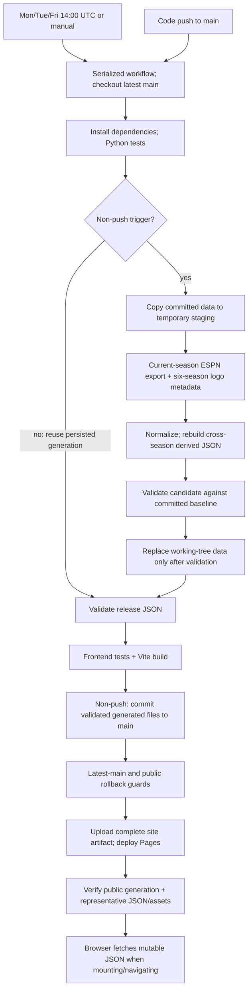

# Live data refresh infrastructure audit

Audit date: 2026-10-30 (public header probes crossed into October 31 UTC). Inspected `origin/main` at `3234824e19c171129f7d0ebaecb40461544166fa`, including the persistence, logo archive, Team of the Week, and weekly-story fixes. This report is the only repository change. No schedules, frontend, secrets, infrastructure, or Basketball Brawl files were changed.

## Decision

**Thirty-minute updates are a reasonable initial cadence using the existing full pipeline. Fifteen minutes is the fastest sensible sustained target on the current hosting infrastructure, after removing unnecessary collection and adding browser generation checks. Five-minute attempts are technically possible with Actions and Pages, but the current full exporter is wasteful and Actions cannot guarantee five-minute delivery. One-minute updates require a different scheduler and an independent live-data publishing path.** These are recommendations, not changes made by this audit.

Keep GitHub Pages for now. First build and measure a narrowly scoped, current-week refresh that reuses validated historical data; keep the existing full refresh daily and after games. Pilot at 15 minutes around actual games, then assess an explicitly best-effort five-minute target. Separate JSON hosting becomes worthwhile if consistent sub-five-minute visibility is a requirement, rather than merely a desired polling interval.

| Requested interval | Current full pipeline | Recommendation |
|---|---|---|
| 30 minutes | Runtime fits comfortably; still repeats expensive collection | Realistic initial rollout with schedule gating and monitoring |
| 15 minutes | Runtime fits; approximately 10,900 ESPN reads/week in the modeled game windows | Practical target after fast-mode optimization; Pages can remain |
| 5 minutes | Approximately 31,300 reads/week; job typically consumes 2–3 minutes, with variable queues and propagation | Optimize first; best-effort only on Actions/Pages, measure missed ticks and public latency |
| 1 minute | Below Actions scheduled-event minimum; serialized jobs would overrun cadence | Architectural change: independent scheduler/worker and small JSON publication, no per-tick site rebuild/commit |

## Evidence and measurement boundaries

- Read the current workflow, exporter, normalization, activity/draft collectors, player metadata/scoring/participation collectors, derived generators, validation, persistence, frontend loading, and installed pinned `espn-api==0.41.0` implementation.
- Used successful [scheduled run 41111383720](https://github.com/fliou0704/pocky-football/actions/runs/41111383720) and [manual run 40992190675](https://github.com/fliou0704/pocky-football/actions/runs/40992190675), plus [latest code deployment 41132396614](https://github.com/fliou0704/pocky-football/actions/runs/41132396614). Scheduled/manual logs precede the latest weekly-story merge; their whole-job timings are evidence, not a benchmark of that subsequent code change.
- Made **10 sequential ESPN GETs**, covering nine distinct representative requests, with existing credentials only on the fantasy host. The broad scoring sample was repeated once after a local reporting error. All returned HTTP 200; no 429, Retry-After, or rate-limit headers observed. This is not a load test. No full export, workflow dispatch, persistence, or deployment was triggered.
- Ran derived generators once in a temporary copy of committed data, without network calls. Validated committed release JSON read-only. Sample sizes below are decoded response bytes, not measured network transfer; gzip was present. Per-request numbers are one local observation, not latency percentiles or CI timings.
- End-to-end request counts are **source-derived counts corroborated by committed coverage and sampled raw data**, not a complete HTTP trace of an Actions run. Existing logs do not record every request, payload size, or exporter substage. Unknown/dynamic quantities remain explicit below.

## Current architecture

The non-push path is `data_refresh.py refresh` → `football_exporter.generate(..., current_only=True)`. `generate.py --current-only` exposes the same exporter selection but is not the workflow entry point. Running `generate.py` without that flag would fetch all six seasons: do not use that as the frequent-update command.

## Pipeline, files, dependencies, and failure behavior

All generated paths below are relative to `frontend/public/data/`; the league prefix is `pocky-football/`.

| Stage | Inputs and processing | Outputs | External work; bottleneck; failure behavior |
|---|---|---|---|
| Setup/test | Latest main, requirements, restored metadata/participation/status caches; Python 3.11 and unit tests | Dependencies, test result | PyPI/action downloads; failure stops before export |
| ESPN collection | Credentials, league 668411840, 2026; library bootstrap, weekly rosters, activity, draft, scores, NFL schedule/participation | In-memory source responses | About 106 ESPN calls at Week 8, plus conditional work. Core library requests lack explicit timeouts; failure may hang until runner/job timeout. Core errors stop generation |
| Normalize/write | Standings and schedule, all elapsed weekly lineup snapshots, current rosters, activity, draft, actual player stats | `2026/{league,teams,home,activity,draft,player-scoring,player-games}.json`; `2026/lineups/1..8.json` | CPU/JSON I/O interleaved with collection, not independently timed in CI. Writes staged atomically per file |
| Logos | Committed archive and six seasons of `mTeam`; source URL/identity evidence | `team-logos.json`, content-addressed SVG/WebP | Optional requests; preserve verified images on failure. Historical sports JSON is not refetched |
| Metadata | Player identities found across 2021–26; nflverse CSV and cached image checks | `players.json`, `player-metadata-audit.json`; private cache files | CSV forcibly downloaded every refresh (`refresh=True`); headshot checks cached by URL. Sleeper is optional and disabled here. Source download failure can abort whole export |
| Derived rebuild | All season snapshots and metadata | `h2h.json`, `h2h/*.json`, `record-book.json`, `players-index.json`, `players/*.json`, `draft-analysis.json`, `draft-scoring-audit.json`, current `team-of-week.json`, all-season `weekly.json`, `site.json` | No additional network in these builders. Recomputes cross-season results each refresh; player profiles and draft analysis dominate measured offline derivation |
| Validate/stage | Candidate plus prior committed snapshot | Accepted staged generation; `refresh.json` hashes/provenance | Parse all JSON, verify identities, completeness, weekly/TW contracts, preserved historical sources. Failure leaves previous working/public data intact |
| Frontend build | Accepted JSON, source, pnpm lockfile | `frontend/dist` containing app and full public data | pnpm install/test/build. Logo catalog is also statically imported into the JS bundle. Failure prevents persistence/deployment |
| Git persistence | Validated and frontend-tested data; latest main | Generated-file-only commit, pushed without force | Rejects main advancing, unrelated staged files, rejected pushes. Bot `GITHUB_TOKEN` push does not create another push-triggered deployment. No-change fetch avoids a metadata-only commit |
| Deploy | Same tested build, latest-main/public rollback guards | Complete Pages release | Serialized `github-pages` group, active run not canceled; failure retains prior release unless deployment already completed |
| Verify | Expected generation/hash manifest | Log/job success or failure | One guard metadata GET; successful verification normally seven public GETs. Up to 12 verification attempts with 15-second waits and 30-second request timeouts. A failed post-deploy check reports failure but does not itself restore an earlier deployment |
| Browser | Built app plus mutable JSON under `/data/` | React state and route-specific data | Initial/route-effect fetches, no timer, push channel, or freshness watcher. Open tabs remain stale. Network failure shows error rather than a live-data stale banner |

## ESPN request accounting

Base `L(y)` = `https://lm-api-reads.fantasy.espn.com/apis/v3/games/ffl/seasons/{y}/segments/0/leagues/668411840`; `S(y)` is the same URL through `seasons/{y}`. All fantasy sports requests below use 2026 except the five historical logo reads.

### Week 8 steady-state count

| Category | Endpoint/view | Season/week | Calls per full refresh |
|---|---|---|---:|
| Library bootstrap | `L`: `mTeam,mRoster,mMatchup,mSettings,mStandings` | 2026 | 1 |
| Library player names | `S/players`: `players_wl`, active filter | 2026 | 1 |
| Library schedule | `S`: `proTeamSchedules_wl` | 2026 | 1 |
| Library draft | `L`: `mDraftDetail` | 2026 | 1 |
| Logo metadata | `L(y)`: `mTeam` | Each 2021–26 | 6 |
| Season matchup normalization | `L`: `mMatchupScore` | Whole 2026 fantasy schedule | 1 |
| Roster/lineup history | `L`: `mMatchupScore,mScoreboard`, week filter | Weeks 1–8 | 8 |
| Activity status/counters | `L`: `mStatus,mSettings,mTeam` | 2026 | 1 |
| Transaction sweep | `L`: `mTransactions2`, scoringPeriodId | Periods 0–9 inclusive | 10 |
| Activity player universe | `L`: `kona_playercard`, stats/history filter | 2026 | 1 |
| Communication corroboration | `L/communication/`: `kona_league_communication` | 2026, pages of 100 | 1 observed (86 topics) |
| Authoritative draft export | `L`: `mDraftDetail,mSettings` | 2026 | 1 |
| Actual player scoring | `L`: `kona_playercard`, 18 actual/projection periods | 2026 weekly stats | 1 |
| Scoring NFL schedule | `S`: `proTeamSchedules_wl` | 2026 | 1 |
| Participation fallback | `sports.core.api.espn.com/v2/sports/football/leagues/nfl/seasons/2026/athletes/{id}/eventlog?limit=100` | Known human players with unresolved GP evidence | 65 inferred and raw-sample corroborated |
| Home current matchups | `L`: `mMatchupScore` then library `mMatchup` | Week 8 | 2 |
| Home recap | `L`: `mMatchup`; `mMatchupScore,mScoreboard`; `S`: `proTeamSchedules_wl`; `L`: `mPositionalRatings` | Week 7 | 4 |
| **Total** | **41 fantasy/metadata calls + 65 public participation calls** | **Current Week 8** | **106 + conditional calls** |

The participation collector uses eight workers and **forces re-fetching eligible eventlogs whenever the season is incomplete**. Restoring that cache does not eliminate these 65 requests. In the committed data, 45 players have eventlog-derived flags; 24 retain unresolved eligible rows, with four overlapping players: 65 distinct eligible IDs. The raw scoring sample independently reproduced 65. The number will change with the player universe and ESPN stat completeness.

General active-season formula with a completed recap: `24 + W + P + C + E + B + U + I`, where W is elapsed roster weeks, P is transaction through-period, C communication pages, E eligible eventlogs, B additional playercard batches, U uncached unresolved event-status probes, I logo/headshot image requests. At this snapshot W=8, P=8, C=1, E=65; B/U expected zero from committed coverage. This is not a fixed ESPN quota or a guaranteed future count.

Conditional additions: missing transaction players/counterparts in batches of 100; communication pagination; schema migration extra scoring/schedule reads; cached unresolved NFL-status lookups; retries/redirects for image sources. Known three unavailable historical upload URLs are rechecked after their negative-cache interval; unchanged valid immutable logo assets are reused, external sources use a seven-day interval. New headshot candidates incur CDN GETs (12 workers); a cold cache can add many requests. Defaults are not safe to treat as zero for every run.

**Historical sports collection is already avoided:** current-only mode reads committed 2021–25 league/lineup/activity/draft/scoring data. It still rereads historical logo metadata and rebuilds derived cross-season files. Within 2026 it unnecessarily repeats completed weekly rosters, every transaction period, an already completed draft, three NFL schedule requests, two broad playercards, and multiple matchup views.

### Conservative request samples

| Request | HTTP | Decoded bytes | Elapsed seconds |
|---|---:|---:|---:|
| Bootstrap five views | 200 | 5,343,919 | 0.477 |
| `players_wl` | 200 | 672,858 | 0.187 |
| `proTeamSchedules_wl` | 200 | 108,947 | 0.123 |
| `mDraftDetail` | 200 | 43,500 | 0.169 |
| `mMatchupScore` | 200 | 214,864 | 0.246 |
| Current-week scoreboard/lineups | 200 | 324,513 | 0.242 |
| Broad `kona_playercard` | 200 | 10,980,738; 1,055 players | 0.576 |
| Activity status/settings/team | 200 | 44,462 | 0.232 |
| Public NFL scoreboard, 2026-11-01 | 200 | 216,264 (17,601 compressed Content-Length) | 0.192 |

The broad player response dominates bytes. The activity collector downloads another broad card response with similar but not identical filtering; reuse must preserve transaction history and score semantics. Do not merge requests blindly. Unmeasured transaction, historical logo, recap, image, and eventlog sizes have not been fabricated. A planning estimate is **35–50 MB decoded upstream data per full refresh**, not a measured compressed transfer total. No whole-export per-endpoint latency distribution is available.

Other upstream traffic: one nflverse release CSV download per full export, potentially redirecting from GitHub to release storage. No Sleeper API request in the configured path. Dependencies/actions/cache downloads are infrastructure traffic, not ESPN traffic. Post-deploy Pages checks are also separate from ESPN requests.

### Rate limits and safeguards

No authoritative published ESPN Fantasy numeric quota or supported API SLA was established. The [library source](https://github.com/cwendt94/espn-api) is a third-party client, not an ESPN service contract. Community reports conflict: some report frequent polling working, others report 403/503 or changing payload behavior. These anecdotes do not establish safe capacity; no community numerical limit is used in the estimates.

Observed: all 10 conservative samples succeeded, with no rate-limit header. This proves access for those samples only. Assumption for capacity planning: request demand scales roughly with successful run count until conditional work/cache effects intervene. It does not prove ESPN permits sustained 5-minute full exports.

Before increasing frequency, introduce explicit connect/read timeouts on **all** fantasy requests, bounded retries for transient failures, Retry-After handling, backoff/jitter, one shared upstream budget, and a circuit breaker for repeated 429/403/5xx. Never retry authentication failures aggressively, log cookies, or use account rotation to evade limits. Current raw logo downloads are already bounded; pinned library GETs are not. Current activity collector can continue sweeping after individual failures, so central circuit breaking matters.

## Measured performance and freshness

Durations below are calculated from timestamped root-step boundaries, including small step-transition overhead. Fetch, normalization, and derived processing share a single CI step and cannot honestly be reported as separately measured CI stages.

| Stage | Scheduled run seconds | Manual run seconds | Requests | Required for live scores? |
|---|---:|---:|---|---|
| Python dependencies | 7.15 | 2.31 | Package downloads | Runtime needed; repeat installs optimizable |
| Python tests | 20.79 | 21.36 | Offline fixtures | Full suite on code changes; live path needs focused contract checks |
| ESPN fetch + JSON generation + derived rebuild + staged validation | 27.10 | 34.32 | About 106 + conditional; nflverse | Only small current-week subset necessary |
| Separate release validation | 2.20 | 2.68 | None | Yes, appropriately scoped |
| pnpm setup + Node/cache setup + install | 15.83 | 9.71 | Registry/cache | No new compilation intrinsically needed for scores |
| Frontend tests + production build | 17.54 | 18.94 | None during build | Site assembly required today; Vite compilation itself only 1.42 s in scheduled run |
| Git persistence | 5.75 | 4.39 | Git fetch/push | Required by current design; not intrinsically by live scores |
| Latest/public rollback guard | 0.80 | 0.93 | Git fetch + one Pages GET | Yes |
| Configure + artifact upload | 2.99 | 3.09 | Full site upload | Required by current publication model |
| Pages deploy action | 6.94 | 6.90 | Deployment API/status checks | Yes today |
| Public verification | 61.64 | 0.93 | Usually seven GETs, more on retries | Yes; propagation was variable |
| **Runner job total** | **185 s (3:05)** | **118 s (1:58)** | — | Includes setup/post steps |

Manual run creation → workflow updated/completed was 3:36, partly because a preceding push deployment occupied the serialized group. Scheduled run creation → update was 7:47; its runner started 3:43 after creation. Its event was created at 18:58 UTC although the configured Friday cron is 14:00 UTC. That is consistent with a severely delayed schedule, but these records do not establish the root cause or a general delay percentile. Never promise an exact cron delivery time from a short exporter benchmark.

Measured scheduled fetch completion timestamp in metadata: 19:03:18.115841 UTC; deployment action completed around 19:04:14.777; public exact-hash verification succeeded 19:05:16.393. Thus **about 57 seconds from recorded fetch completion to deploy completion and 118 seconds to confirmed public visibility**. The metadata timestamp occurs after derivation/first validation, not at the last ESPN response, so ESPN-response-to-public latency is somewhat greater. Plan roughly 1–3 minutes after collection for publication/verification in healthy runs, plus unbounded schedule/queue delay; not a delivery guarantee.

One offline benchmark of latest-main generators on this local machine, against a temporary copy: copy 0.912 s, H2H 0.502 s, records 1.952 s, player profiles 6.481 s, draft analysis 3.959 s, current TW 0.549 s, six-season weekly stories 0.133 s; read-only release validation 4.035 s. Derived sum 13.576 s. These are local one-pass timings, not additive components to subtract from the earlier CI runs.

## Usage model

Assume 24 active hours/week across Thursday (~5.5 h), Sunday (~13 h), Monday (~5.5 h), including 60-minute pregame and postgame margins, plus seven daily baseline runs. A Sunday international kickoff can extend the union toward 28 hours; Saturday/holiday slates can reach 35–40. These are planning windows, not a claim every future week has those exact durations. The sampled November 1 scoreboard contains 12 games across 13:00, 16:05, 16:25, and 20:20 US Eastern; actual completion times remain unknown before play.

`runs = 7 + activeHours × 60 / intervalMinutes`, rounded for scheduling. Baselines overlapping a live tick can be coalesced, so this is conservative. Model 3.1 runner-minutes/run from observed scheduled runtime; separate column rounds to four minutes for private-plan budgeting, not a bill for this public repository. Every run currently builds/deploys even if semantic data is unchanged. At most one data commit per changed run; no-change suppression lowers commits but does not skip deployment.

| Cadence | Runs/week | Runner min/week (~3.1 each) | Rounded budget min | Max data commits / Pages deployments | ESPN reads (~106/run) | Site bytes assembled/week | Compressed artifact upload/week |
|---|---:|---:|---:|---|---:|---:|---:|
| Daily only | 7 | 22 | 28 | ≤7 / 7 | 742 | 0.51 GB | 0.03 GB |
| 30 min during games | 55 | 170 | 220 | ≤55 / 55 | 5,830 | 4.04 GB | 0.23 GB |
| 15 min during games | 103 | 319 | 412 | ≤103 / 103 | 10,918 | 7.57 GB | 0.42 GB |
| 5 min during games | 295 | 914 | 1,180 | ≤295 / 295 | 31,270 | 21.67 GB | 1.21 GB |
| 1 min hypothetical | 1,447 | 4,486 | 5,788 | ≤1,447 / 1,447 | 153,382 | 106.28 GB | 5.93 GB |

Measured generated data size is 73,448,005 bytes; full site is approximately 73 MB. Scheduled compressed artifact was 4,100,687 bytes. Assembly/upload columns are separate quantities, not visitor bandwidth. At 35–50 MB decoded upstream per run, five-minute full refreshes process approximately 10.3–14.8 GB upstream/week; compressed ESPN transfer is unmeasured. At 28 active hours, 5-minute runs become 343/week; at 40 hours, 487/week. Cold caches and later-season W/P growth increase work further.

A five-minute schedule checker running all week would itself launch **2,016 jobs/week**, of which only ~288 are live-window ticks in this model. Even at an assumed 10–30 seconds per idle check, idle jobs alone consume ~288–864 runner-minutes/week before fantasy work. Calling this checker “lightweight” does not make runner setup free. A 15-minute all-week checker has 672 runs; an inexpensive persistent/external scheduler may ultimately be cleaner, but none is being introduced here.

Repository growth: the last scheduled data commit changed 557 files totaling 36.7 MB of rewritten current file content, largely generated profiles/metadata. That is **not** 36.7 MB of added Git storage: Git compression/deltas and timestamp-only diffs change actual growth substantially. At 295 changed refreshes, this pattern would rewrite 10.8 GB of file content/week and create thousands of commits/season. A 1–50 KB compressed-delta-per-commit sensitivity range implies ~0.3–14.8 MB/week at five minutes, but this is illustrative, not measured future pack growth. Track actual packed repository growth during a pilot. Current local `.git` is ~35 MB (includes local branches); GitHub reports repository size 6,811 KB. Full-history checkout means future growth affects every run.

### GitHub constraints

- [Scheduled workflows](https://docs.github.com/en/actions/reference/workflows-and-actions/events-that-trigger-workflows#schedule) support a minimum five-minute interval; runs can be delayed or dropped, use the default branch, and public schedules can disable after 60 inactive days. An offset minute avoids the busiest hour boundary but provides no timing SLA.
- [Concurrency](https://docs.github.com/en/actions/how-tos/write-workflows/choose-when-workflows-run/control-workflow-concurrency): current configuration retains the active run and by default at most one pending run; new pending work replaces older pending work. `cancel-in-progress: false` is not an unlimited FIFO queue. Keep single-writer publication and re-resolve latest main when starting.
- [Pages limits](https://docs.github.com/en/pages/getting-started-with-github-pages/github-pages-limits): site ≤1 GB, recommended source repository ≤1 GB, 100 GB/month soft visitor bandwidth, 10-minute deployment timeout. The ten-builds/hour soft cap **does not apply to this custom Actions workflow**. Thus twelve deployments/hour is not prohibited by that particular cap; operational churn, rate limiting, queues, and cache propagation still matter.
- [Actions billing](https://docs.github.com/en/billing/concepts/product-billing/github-actions): this public repository uses standard Ubuntu runners, so runner use is free; do not apply a private-repository minute quota to it. Artifact/cache accounting remains distinct. Current metadata cache is ~2.45 MB restored and pnpm cache ~20.7 MB; run-specific metadata keys create repeated cache entries subject to retention/eviction.
- [Pages artifact action](https://raw.githubusercontent.com/actions/upload-pages-artifact/v4/action.yml) defaults to one-day retention, confirmed in this run. At ~4.1 MB each, a ~13-hour Sunday five-minute period could retain roughly 160 artifacts/~0.66 GB including baseline runs. Account-specific storage policy/charges were not audited; do not assume free compute means unlimited free artifact storage. Avoid treating the default 90-day general artifact policy as the actual Pages policy.

## Recommended fast/full boundary

**Fast mode proposal:** fetch a current-period score/lineup view, necessary team/roster/status metadata, and one reusable NFL scoreboard/schedule status view. Target **2–4 fantasy calls plus one NFL scoreboard call per tick**, subject to proving raw-view completeness; this is a design target, not measured implemented behavior. Avoid constructing the default `League` object if its four bootstrap reads are unnecessary. Fetch only rostered/relevant players if a supplemental playercard is needed; never use generic NFL points instead of the league's applied scoring.

Publish one compact, versioned current-season live contract: league/season IDs, matchup/scoring period IDs, stable team/player IDs, team totals, current lineup slots, known player fantasy scores, injury/availability and NFL event status, fetchedAt, schema version, source revision, generation ID, base full-generation ID, and per-source success/as-of status. Unknown points/status must remain null/unknown; live zero, negative scores, and legitimate corrections are valid. Projected points must stay separate from actuals.

Fast mode must update Home, Scoreboard, current team roster/lineup displays from a common overlay to prevent divergent totals. Standings should remain explicitly through completed games; do not silently recompute season wins from live scores. Historical screens, records, draft evaluation, completed recaps, and Team of the Week can retain their validated full generation. Label their as-of scope. Week advancement/finality should trigger a full refresh, not a partially rebuilt recap. Existing all-play/weekly stories and TW contracts are source-coupled: either leave their base sources unchanged under an overlay, or rebuild the affected contracts atomically. Simply skipping builders while overwriting their inputs will fail validation or produce inconsistencies.

**Full mode proposal:** existing validated pipeline daily; additionally after a complete NFL slate/week and next morning, with another correction sweep 24–48 hours later. Reuse immutable/completed historical roster/draft/participation data, refresh biographies/logos on a slower TTL, coalesce duplicated matchup/schedule/playercard requests where semantics agree. Keep explicit historical maintenance commands for later corrections; baseline validation currently intentionally rejects historical source changes in the ordinary current-only refresh.

Preserve existing staged acceptance, narrow generated-file persistence, latest-main checks, and public rollback protection. Extend generation validation to cover mode/base-generation and acquisition time, so a newer small live overlay cannot be overwritten by an older full snapshot. Prefer immutable generation directories and publish a pointer last; accept all needed data in React in one state update. Historical/current identity must remain season-scoped.

## Schedule-aware activation

| Option | Complexity | Reliability and usage |
|---|---|---|
| A: daily | Low | Good baseline/corrections; misses live updates |
| B: typical Thu/Sun/Mon windows | Low–medium | Wasteful idle polling; misses international/Saturday/holiday/rescheduled games |
| C: actual NFL game windows | Medium | Correct calendar coverage; requires game-state persistence, refresh and failure rules |
| D: cached schedule gate plus active-window fantasy refresh | Medium | Recommended balance; avoids full exports when no games, but checker runner overhead must be counted |

The existing fantasy `proTeamSchedules_wl` provides event IDs and kickoff milliseconds, and the collector already uses official-stat evidence and occasional core event-status probes. It is not by itself a reliable delayed/live/final clock. The sampled public ESPN scoreboard endpoint `https://site.api.espn.com/apis/site/v2/sports/football/nfl/scoreboard?dates=20261101` returned dates, event IDs, and `status.type.{name,state,completed,detail}` without credentials. This is observed service behavior, not an officially supported contractual schema.

Recommended state machine: daily discover/cache upcoming events for a rolling 7–14-day horizon; during quiet days recheck calendar every 30–60 minutes if practical; activate 60 minutes before the earliest uncompleted kickoff. During the active window refresh scoreboard status and fantasy data at the pilot cadence. Keep active while **any** relevant event is live/delayed or an imminent scheduled event remains; union overlapping kickoff windows rather than starting a process per game. Stop 60 minutes after the last confirmed final/canceled event, not a guessed three-hour duration. Persist event IDs, actual state and last-final time; update kickoff times on rescheduling, use UTC internally, and include neighboring UTC dates so evening US games are not lost at midnight.

Treat postponed/suspended/unknown events separately from final: rescheduled date returns to future monitoring; unresolved same-day delays get bounded continued checks and an alert, not permanent tight polling. On schedule failure use last-known windows with a conservative grace period and backoff; do not interpret an empty response as “all games over.” Add a safety cap that escalates for review rather than silently stopping a still-live game. Holiday and international behavior follows event timestamps, with no hardcoded weekday assumptions.

No alternate calendar provider is already integrated. A second provider such as an official NFL schedule could be corroborative later, but its machine-readable stability/authentication were not verified here; it is not proposed as an untested dependency. Start by combining the already-used ESPN pro schedule with scoreboard status and last-known-good state. For strict five-minute freshness, an external clock may ultimately be necessary even if collection remains in Actions.

## Browser updates and caching

`frontend/src/main.jsx:getData` calls ordinary `fetch` with browser-default caching. `site.json` is loaded once at mount; current league once per manifest; selected season/home/team data on route/season effects. Other pages have their own effect loads. No setInterval, EventSource, WebSocket, service worker, or use of `refresh.json` to invalidate React state was found. Switching route may fetch again, but an open matchup page never updates by itself.

Public probes returned **`Cache-Control: max-age=600`**, ETag, Last-Modified and gzip for both `refresh.json` and current `home.json`. A five-minute publisher with ordinary fetch may still show ten-minute-old cached JSON; an open tab can remain stale indefinitely. Deployment success is not proof that every CDN edge/browser has accepted the new version.

Browser proposal: while visible/online, check a **small** generation pointer every 30–60 seconds (independent of slower fantasy collection); pause when hidden, recheck on focus/reconnect, back off on errors. Existing refresh manifest was ~88 KB decoded/~35 KB gzip because it includes every data hash, so introduce a compact public pointer rather than download the full verification manifest each minute. Use explicit revalidation or no-store plus a bounded cache-busting policy for the pointer, then generation-keyed immutable URLs for changed data. A generation query on mutable paths alone cannot guarantee old bytes will not race a deployment; verify hashes and retry without replacing valid UI state.

Keep route/hash, selected season/team/week, tabs, scroll and expanded cards in separate state. Refresh only active live-facing slices; replace coherent data atomically and retain old values with a stale/error indicator if any required response fails. Avoid remounting the app or resetting `ScoreboardPage`'s selected week. Include all loaders' cache keys, such as weekly/TW and player detail, in the generation strategy. The statically imported logo catalog changes only with a new app bundle; existing open tabs need a dynamic catalog or an explicit app-version update path for new branding.

## Data hosting decision

| Approach | Cost/complexity | Freshness, reliability, security |
|---|---|---|
| Current Pages | No new account; simplest | Adequate for 15–30 minute best-effort data releases. Full-site artifacts/commits per tick; limited cache-header control and deploy latency |
| Raw GitHub JSON | No new account; modest integration | Avoids Pages rebuild but still requires commits, GitHub/CDN caching and consistent generation paths. Not a latency SLA; using authenticated API reads would require a server and must never expose a token in React. Poor long-term live feed |
| Object storage, e.g. R2 | New credentials, domain/CORS/cache/lifecycle setup; small workload may fit free allowance | Small immutable JSON plus atomic pointer avoids Git churn and frontend builds. Control TTLs; private scoped write credentials on exporter, public sanitized read-only objects. Must test propagation/rollback |
| Worker plus object storage | More implementation and operational ownership | Independent minute scheduler/short-lived publisher and caching control. Existing Python full exporter is not a drop-in Worker workload; keep full processing in Actions |

[R2 Standard pricing](https://developers.cloudflare.com/r2/pricing/) currently includes 10 GB-month storage, 1 million Class A and 10 million Class B operations/month, with free egress; exceeding allowances can cost money. A tiny feed likely fits, but no account was created and no paid services were introduced. For production, [R2 public bucket guidance](https://developers.cloudflare.com/r2/buckets/public-buckets/) recommends an appropriate custom-domain setup; `r2.dev` is for non-production use. Browser request volume depends on actual visitors, not just publisher cadence. Other free-tier static hosts have their own deploy quotas; moving the whole site without changing publication granularity does not solve the main problem.

**Do not migrate yet.** Prove the small collector and measure public age first. If reliable five-minute or one-minute delivery is subsequently required, keep React/static history on Pages and publish only the small live feed independently, with periodic validated snapshots retained in Git for recovery/audit.

## Integrity requirements before any rollout

1. Retain atomic staging, stable IDs, season boundaries, null-vs-zero semantics, score finite-number checks, nonempty roster/participant checks, valid matchup periods, last-good retention, generation hashes, and monotonic publication revisions. Scores themselves are not monotonic: corrections can reduce totals.
2. Separate collector health (`lastCheckedAt`, per-source success/failure, `lastChangedAt`) from last persisted successful changed generation. Today an unchanged check leaves `lastSuccessfulEspnFetchAt` unchanged; only the run log reports the newer successful check. Do not falsely label unchanged data as a broken exporter or label a failed partial check as fresh.
3. Never let optional biography/image/history failures block a valid live overlay. Conversely, do not relax full-export completeness gates globally: today's activity status must be independently verified/likely complete, draft complete, scoring conflict-free, and derived TW/weekly exact. Introduce a separate explicit live schema/validator rather than bypass those checks.
4. Validate source consistency when multiple views are fetched over seconds: compare team/period identities and totals, handle a stat update between reads with bounded retry, and retain the previous generation if coherence cannot be established. Current repeated matchup fetches can race a live score change.
5. Full refreshes remain necessary after finals and later corrections. A game's final flag does not guarantee final fantasy statistics, transaction coverage, standings, or recap availability. Reconcile rather than freeze the first final response forever.
6. Single publisher, no force pushes, public-generation guard, latest-base verification; interrupted/queued runs must not replace newer data. If main advances during export, reject/retry on current main. Treat publication verification failure as actionable even when the deployment action succeeded.
7. Monitor collected-at → published-at → browser-visible age, duration percentiles, API call/byte counts, 429/403/5xx, skipped/replaced runs, unchanged ratio, cache hit rate, artifact retention, and packed Git growth. Never place private raw responses, cookies, owner identifiers, or signed authenticated URLs in public live data/logs.

## Phased roadmap

1. **Next implementation task: instrumentation and fast-mode contract, with schedules unchanged.** Add redacted per-endpoint call/byte/time metrics and explicit timeouts; implement a current-week-only collector/validator in shadow mode. Replay captured/sanitized fixtures and compare scores/lineups against the existing full exporter. Target 2–4 fantasy reads/tick and a compact live contract; establish actual upper bounds before enabling frequency.
2. Separate slow biography/logo/activity/draft/participation work from frequent updates, preserving full-refresh correction paths and all historical validations. Deduplicate only semantically compatible source responses. Confirm no fantasy scoring or identity regressions.
3. Add generation-aware React updates and caching controls, preserving season/week/team/navigation. Validate coherent data replacement, offline/hidden-tab behavior and stale indicators. Test desktop/mobile with zero, negative, corrected, delayed and missing scores.
4. Add schedule discovery/state/gating, initially 30 minutes with daily baseline and postgame/correction refreshes. Use actual event timestamps, safe failure behavior, monitoring and rollback exercises. Inspect at least a Thursday/Sunday/Monday cycle plus simulated international/Saturday/postponement cases.
5. Pilot 15 minutes; measure API consumption and end-to-end browser-visible percentiles. Suppress unchanged site deploys and unnecessary Git commits without losing a separate collector-health signal. Review artifact/cache retention and repository growth.
6. Consider five minutes only after the pilot. Actions/Pages can support best-effort attempts if optimized jobs finish comfortably within the interval; publish the scheduler's timing limitations visibly. If required latency cannot tolerate cron/Pages delays, propose a separately approved small object-store feed and external clock. One-minute publication belongs in that architecture, not a cron change to the present workflow.

## Audit validation and remaining uncertainty

Committed release validation passed, and all six derived builders completed against a temporary copy. No production code changed, so code test suites/build were not rerun just to validate Markdown; successful CI logs supplied the relevant timing evidence. Checked report arithmetic, repository scope, and diff. No production refresh/deployment was performed by this audit.

Unresolved measurements: full HTTP trace and compressed upstream bytes per run; late-season/cold-cache worst-case requests; live-game source consistency; actual browser-visible latency percentiles across CDN edges; sustained ESPN rate allowance; account-specific artifact storage billing. These are explicit pilot/instrumentation work, not reasons to assume five-minute full exports are safe. Existing infrastructure is sufficient for the first optimized rollout; a strict real-time service requires stronger scheduling/publication guarantees.
